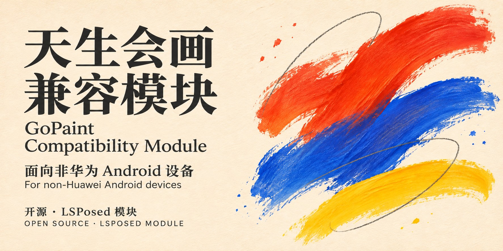
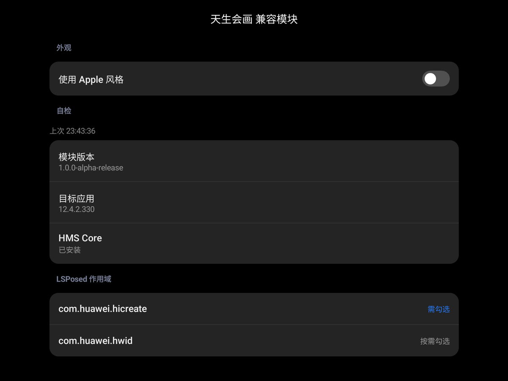
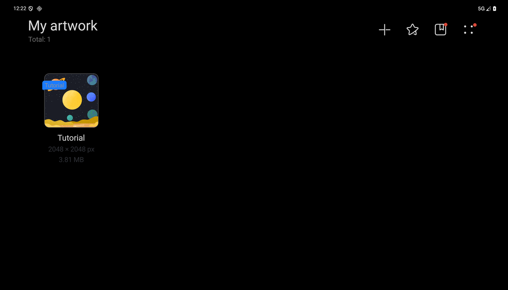

<h1 align="center">GoPaint Compatibility Module</h1>

<strong>天生会画兼容模块</strong>

Huawei GoPaint on non-Huawei Android devices. 让更多非华为 Android 设备用上天生会画。

  

  <a href="docs/INSTALL.en.md">Installation</a> ·
  <a href="docs/COMPATIBILITY.md#english">Compatibility</a> ·
  <a href="https://github.com/Orynnx/HiCreate-Regulated/issues/new/choose">Get help</a> ·
  <a href="README.md">简体中文</a>

  
  
  

This LSPosed module provides runtime compatibility for the original **Huawei GoPaint
(天生会画 / HiCreate)** app on non-Huawei Android devices. Install a separate
LSPosed module while keeping the original app APK.

> **Before you start:** Root, LSPosed API 102 and Zygisk or an equivalent injection
> environment are required. Use the stock `com.huawei.hicreate` **12.4.2.330** APK.
> Current module: **1.0.0-alpha-release**.
> See the [compatibility record](docs/COMPATIBILITY.md#english) for the tested environment and remaining gaps.

## What it brings

- **Startup compatibility** — Handles startup, device checks, resources and widgets on non-Huawei devices.
- **Drawing and artwork operations** — Compatibility handling for brushes, sessions, file picking and sharing.
- **Simple management** — Compatibility is applied after enabling the module; inspect app versions and choose Miuix or Apple styling.

See the [hook list](docs/HOOKS.md) for the implementation and the
[compatibility record](docs/COMPATIBILITY.md#english) for testing status.

## Take a look

<table>
  <tr>
    <th width="50%">Miuix</th>
    <th width="50%">Apple style · Android 13+</th>
  </tr>
  <tr>
    <td></td>
    <td></td>
  </tr>
</table>

The status page follows the system light/dark theme and refreshes when you return.
The appearance switch affects the module page only.

View the GoPaint home screen

This existing screenshot shows the app's home screen.
See the [testing record](docs/COMPATIBILITY.md#english) for the scope of available evidence.

## Installation

1. **Prepare the environment** — Install stock GoPaint `12.4.2.330` and have Root plus an LSPosed environment supporting API 102 ready.
2. **Install the module** — Download and install `HiCreate-Regulated-*.apk` from [Releases](https://github.com/Orynnx/HiCreate-Regulated/releases/latest).
3. **Enable and open** — Enable the module in LSPosed, select `com.huawei.hicreate`, and also select `com.huawei.hwid` if HMS Core is installed. Force-stop GoPaint and reopen it.

**[Full installation guide and troubleshooting →](docs/INSTALL.en.md)**

The download is the compatibility module; install the drawing app separately.
Scope labels on the status page are setup instructions. The page cannot read
LSPosed's selected scopes or confirm that hooks are active.

## Compatibility

| Scope | Current record |
|---|---|
| Tested device | Samsung Galaxy Tab S8+ / One UI 8.0 |
| Target app | Stock `com.huawei.hicreate` `12.4.2.330` |
| Android | Android 12 minimum; Apple styling needs Android 13 |
| Other non-Huawei devices | Need model-specific testing; [share a result](https://github.com/Orynnx/HiCreate-Regulated/issues/new?template=compatibility.yml) |
| Android 17 | Not yet validated; the status page displays a notice |

[Testing boundaries and feature checklist →](docs/COMPATIBILITY.md#english)

## Frequently asked questions

Does it work without root?

Root, LSPosed API 102 and a compatible injection environment are required.

Does it support other versions or repackaged GoPaint APKs?

Only stock `12.4.2.330` is currently supported. Other versions and repackaged APKs
are outside the supported input. The module does not modify or re-sign the target
APK; native compatibility uses a copy in the app's private data directory.

Why does the page say the scope must be selected or the app is missing?

Scope labels are setup instructions; confirm them in LSPosed.
For a missing app, check that the module and GoPaint are installed in the same
Android user or work profile. See the [installation guide](docs/INSTALL.en.md).

Why does installing a new module version fail?

If Android reports a signature conflict, an older module may have a debug signing
key. Uninstall that compatibility module, install the release and enable it again
in LSPosed. GoPaint itself does not need to be uninstalled for this.
For other installation errors, [report the exact message](https://github.com/Orynnx/HiCreate-Regulated/issues/new?template=bug_report.yml).

## Help improve compatibility

Questions, device test results, clearer instructions and translations are all welcome.
If you have any issue or question with this project, please don't hesitate to get in touch.

**[Report a problem](https://github.com/Orynnx/HiCreate-Regulated/issues/new?template=bug_report.yml)** ·
**[Share device compatibility](https://github.com/Orynnx/HiCreate-Regulated/issues/new?template=compatibility.yml)** ·
**[Contribute](CONTRIBUTING.md#english)**

## Developer documentation

[Build](docs/BUILD.md) · [Architecture](docs/ARCHITECTURE.md) ·
[Hooks](docs/HOOKS.md) · [Native compatibility](docs/NATIVE.md) · [Third-party components](docs/THIRD_PARTY.md)

Implementation documents are currently in Chinese.

## License

Original source is licensed under [Apache-2.0](LICENSE).
[NOTICE](NOTICE) describes the separate scope of Huawei runtime assets and derived
compatibility data. See [THIRD_PARTY_NOTICES.md](THIRD_PARTY_NOTICES.md) for other components.
Huawei payloads are not included in the source tree; release APKs contain locally
supplied payloads with separate redistribution terms.

Unofficial project, not affiliated with or endorsed by Huawei.
