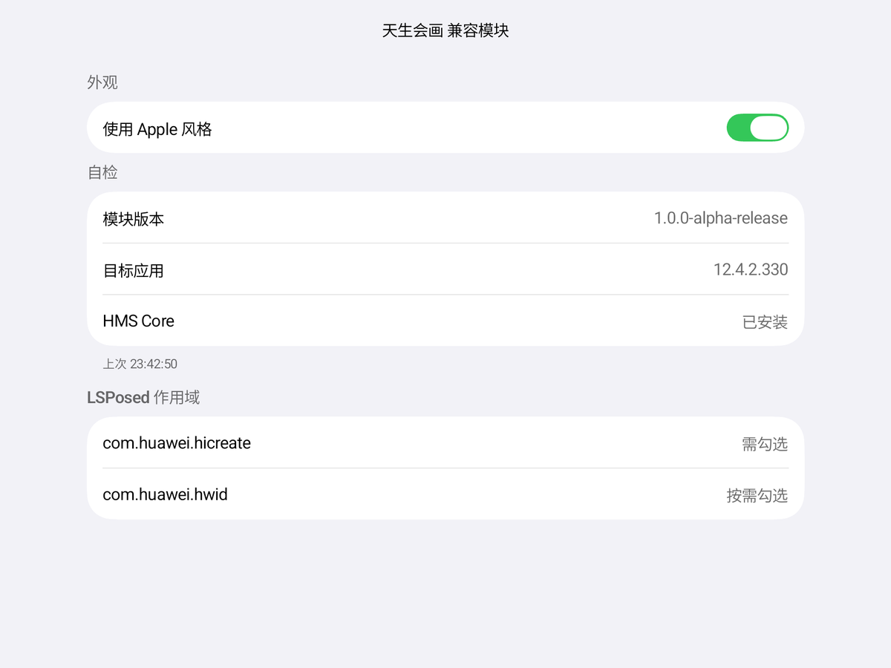

# Huawei GoPaint for non-Huawei Android · HiCreate Regulated

[简体中文](README.md) | English

**HiCreate Regulated** is an LSPosed compatibility module for the original
**Huawei GoPaint** app, also known as **天生会画 / HiCreate**, on non-Huawei Android
devices. It targets `com.huawei.hicreate` version `12.4.2.330`.

**[Download the module APK](https://github.com/Orynnx/HiCreate-Regulated/releases/latest)**
· [Installation](#installation)
· [Compatibility](#compatibility)
· [Report an issue](https://github.com/Orynnx/HiCreate-Regulated/issues)

**Version:** `1.0.0-alpha-release`

Root, LSPosed API 102 and Zygisk or an equivalent injection environment are required.
The module works with the stock target APK without modifying or re-signing it.

## Compatibility

| Item | Requirement or test status |
|---|---|
| Target app | Stock `com.huawei.hicreate` `12.4.2.330` |
| Injection framework | LSPosed API 102, such as Vector 2.x; root required |
| Android | Android 12+; the Apple-style status page needs Android 13+ |
| Tested device | Samsung Galaxy Tab S8+, One UI 8.0 |
| Other devices | Require testing; the project targets non-Huawei Android devices |
| Android 17 | Not yet validated; the status page displays a compatibility notice |

Compatibility on other device models needs verification.
Other app versions and repackaged target APKs are unsupported.

## What the module does

- Provides startup, device-check, permission, resource and widget compatibility.
- Handles brush/session behavior, file picking and sharing.
- Adds network/store request compatibility and HMS package/signature handling.
- Validates and patches a private copy of `libnativelib.so` inside the target
  app's data directory.
- Provides a Compose status page with Miuix and Apple-style Glasmio appearances.

Compatibility hooks are installed automatically. The appearance switch only changes
the module's status page. No module logs or diagnostic reports are generated.
See the [hook list](docs/HOOKS.md) and [architecture](docs/ARCHITECTURE.md)
for implementation details (Chinese).

## Installation

1. Install the stock GoPaint / 天生会画 `12.4.2.330` APK and set up an LSPosed
   environment that supports API 102.
2. Download `HiCreate-Regulated-*.apk` from
   [GitHub Releases](https://github.com/Orynnx/HiCreate-Regulated/releases/latest)
   and install it. This is the module APK; install the drawing app separately.
3. Enable the module in LSPosed.
4. Select `com.huawei.hicreate` in its scope. Also select `com.huawei.hwid`
   if HMS Core is installed.
5. Force-stop GoPaint and reopen it.

The scope labels on the module's status page are setup instructions, not live
activation indicators. The page checks the installed app versions and HMS Core
presence; it cannot read LSPosed's scope selection or confirm that hooks are active.

## Status page

Open the module to inspect installed versions and choose its appearance. It follows
the system light/dark theme and refreshes the checks when you return to the page.
The Apple-style appearance requires Android 13+; Android 12 uses Miuix.





## Frequently asked questions

### Can I use GoPaint on a non-Huawei device?

That is the purpose of this module. Use the exact target app version and framework
listed above. The tested device is recorded in the compatibility table; support
for every Android device is not established.

### Does it work without root?

No. Root, LSPosed API 102 and a compatible injection environment are required.

### Is this a GoPaint APK download or a modified drawing app?

It is a separate LSPosed module. The original drawing app must be installed
separately. The module does not modify or re-sign that APK.

### Why does the page say the scope needs to be selected?

Those labels describe the required setup, not your current LSPosed configuration.
Check the scope in LSPosed itself.

### Why does a new module version fail to install?

An older module build may use a debug signing key. Uninstall that module build
before installing the release, then enable the module and select its scope again.

## Build from source

Use JDK 21, Android SDK 37 and the Gradle wrapper. Huawei runtime assets are not
included in the source repository; supply them locally. Release builds also require
the signing configuration described in the [build guide](docs/BUILD.md) (Chinese).

```powershell
.\gradlew.bat :app:assembleRelease "-PassetsDir=C:\path\to\assets"
```

The source repository does not contain Huawei runtime payloads, prebuilt APKs,
keystores or signing credentials. Release APKs contain locally supplied Huawei
runtime payloads; their redistribution terms are separate from the source license.

## Feedback

If you have any issue or question with this project, please don't hesitate to
[open an issue](https://github.com/Orynnx/HiCreate-Regulated/issues). Include your
device model, Android version, LSPosed version, GoPaint version and reproduction steps.

## License

Original project source is licensed under [Apache-2.0](LICENSE).
[NOTICE](NOTICE) describes attribution and scope; Huawei runtime assets and
derived compatibility data are outside that license.
See [third-party notices](THIRD_PARTY_NOTICES.md) for other components.

This is an unofficial project and is not affiliated with or endorsed by Huawei.
