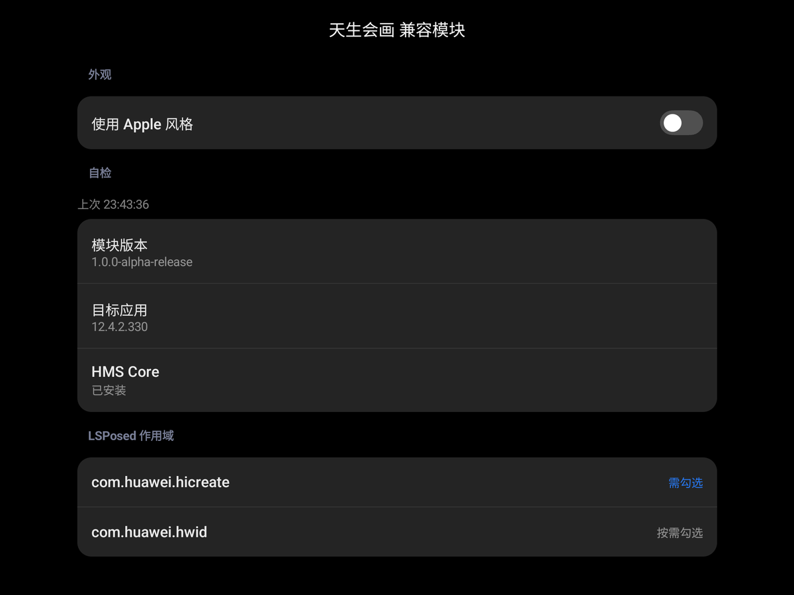
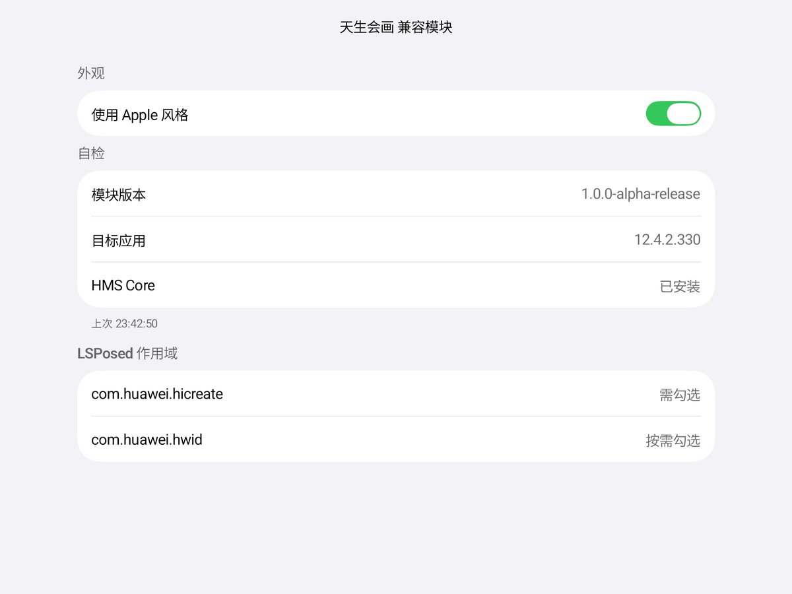
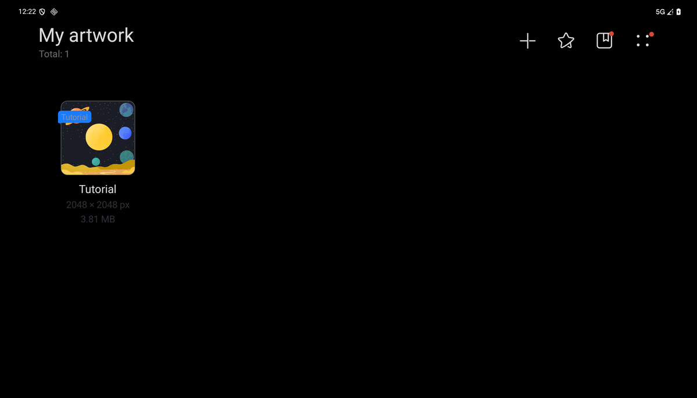

# HiCreate Regulated

## 如果您使用中有任何问题，您都可以联系我，我很乐意和您交流并与您一同解决这些问题。
## If you have any issue or question with this project, please don't hesitate to let me know.

此模块在Galaxy Tab S8+，One UI8.0经过测试。

原版「天生会画」的独立 LSPosed 兼容模块。

**版本：** `1.0.0-alpha-release`

> 需要 root、LSPosed API 102 和 Zygisk/同等注入环境，不是免 root 方案。  
> 只支持原版 `com.huawei.hicreate` `12.4.2.330`；不修改、不重签目标 APK。

## 兼容性

| 项目 | 要求 |
|---|---|
| 目标应用 | `com.huawei.hicreate` `12.4.2.330`，原版 APK |
| 注入环境 | LSPosed API 102（如 Vector 2.x），需要 root |
| Android | 12+；Apple 风格页面需要 13+ |
| Android 17 | 尚未完成兼容验证；状态页会提示 |
| 模块设置 | 仅「使用 Apple 风格」外观开关 |
| 日志 | 不写日志，不生成报告 |

其他版本或已重打包的目标 APK 不支持。

## 功能

- 修复非华为设备上的启动、设备检查、权限、资源和控件兼容；
- 修复笔刷、会话、文件选择器、分享和网络/商店兼容；
- 在应用私有目录校验并补丁 `libnativelib.so`，不修改 APK；
- 在 HMS 进程处理包信息与签名兼容。

Hook 明细见 [docs/HOOKS.md](docs/HOOKS.md)。

## 安装

1. 安装 Release 页面的签名 APK（源码仓库不提交 APK；APK 内含运行所需华为载荷）；
2. 在 LSPosed 中启用模块；
3. 作用域勾选 `com.huawei.hicreate`；有 HMS Core 时再勾选 `com.huawei.hwid`；
4. 强制停止并重新打开天生会画。

作用域中的“需勾选 / 按需勾选”是要求清单，不是实时状态；模块无法读取
LSPosed 的勾选配置。

## 使用

1. 打开「天生会画 兼容模块」状态页。
2. 查看「自检」：模块版本、目标应用版本、HMS Core 是否安装。
3. 按需开启「使用 Apple 风格」，只改变状态页外观，不影响 Hook。
4. 打开天生会画；首次启动和首次进入画布可能稍慢。
5. Android 17 上会弹出兼容性提示，确认后继续使用。

状态页跟随系统深浅色；每次返回页面都会重新自检。

## 界面

Miuix 默认外观：



Apple 风格（Glasmio，Android 13+）：



模块启用后，天生会画可以正常进入主界面：



## 外观

「使用 Apple 风格」只切换状态页外观：

- 关闭：Miuix；
- 开启：Glasmio（Android 13+）；
- Android 12 自动保持 Miuix。

## 常见问题

- **目标应用显示未安装**：确认已安装目标应用，并在 LSPosed 中勾选作用域。
- **作用域显示需勾选**：这是要求清单，不是未勾选状态。
- **Apple 风格无法开启**：Android 12 不支持，自动回退 Miuix。
- **Android 17 弹窗**：表示模块尚未完成该版本的兼容验证；当前仍可尝试使用。
- **新版本安装失败**：旧版可能是 debug 签名，卸载旧版后重装，并重新启用作用域。

## 构建

要求 JDK 21、Android SDK 37、Gradle wrapper。华为运行时资产不随仓库提供：

```powershell
.\gradlew.bat :app:assembleRelease "-PassetsDir=C:\path\to\assets"
```

release 缺少资产会直接失败。签名、`local-assets/` 和构建细节见
[docs/BUILD.md](docs/BUILD.md)。

源码仓库不包含华为资产、预编译 APK、keystore 或签名凭据。Release APK
由本地资产构建，内含华为运行时载荷；其再分发范围由使用者自行确认。

## 许可证

自有源码使用 [Apache-2.0](LICENSE)。`NOTICE` 是归属与范围声明，不是许可证；
它说明华为运行时资产和派生兼容数据不在 Apache-2.0 范围内。第三方许可见
[THIRD_PARTY_NOTICES.md](THIRD_PARTY_NOTICES.md)。

非官方项目，与华为无隶属或背书关系。
