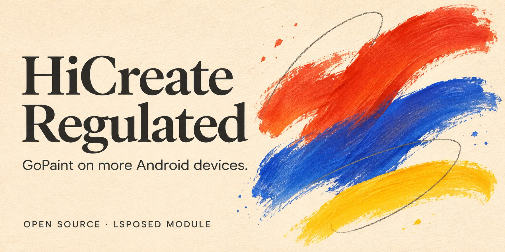
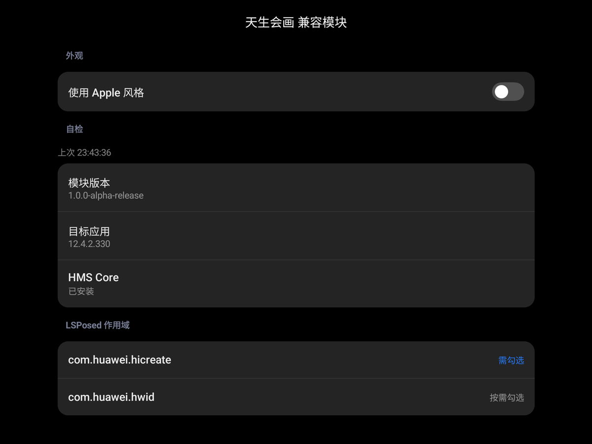
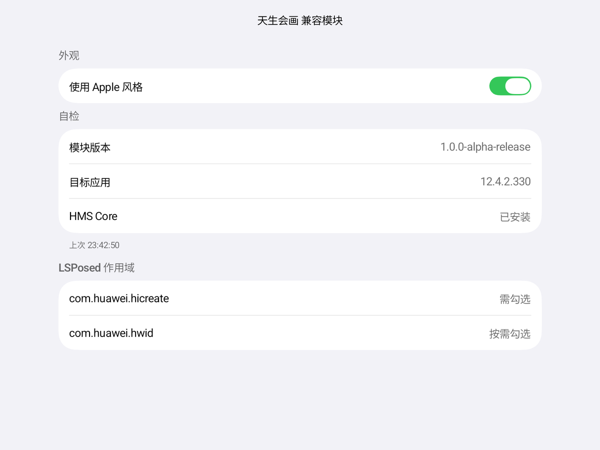
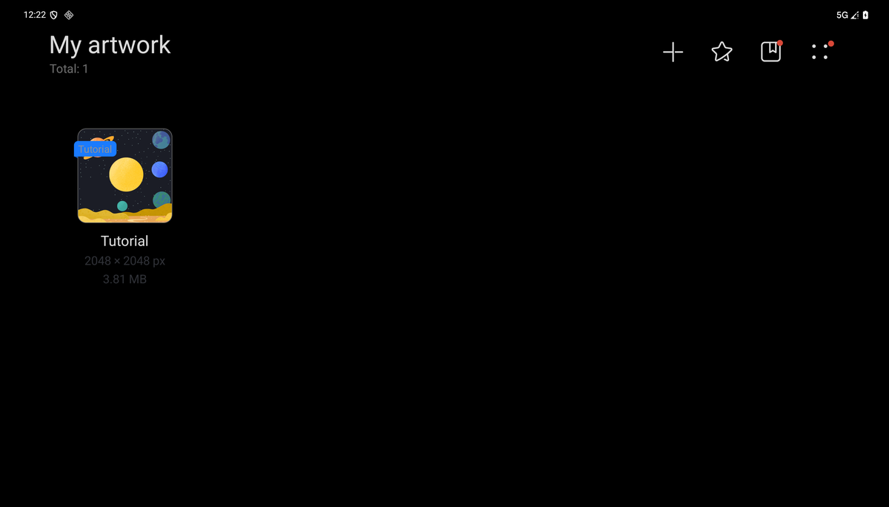

<h1 align="center">天生会画 / GoPaint 非华为兼容模块</h1>

让更多 Android 设备用上天生会画。

  

  <a href="docs/INSTALL.md">安装指南</a> ·
  <a href="docs/COMPATIBILITY.md">兼容性与测试</a> ·
  <a href="https://github.com/Orynnx/HiCreate-Regulated/issues/new/choose">反馈问题</a> ·
  <a href="README.en.md">English</a>

  
  
  

HiCreate Regulated 为原版 **天生会画（Huawei GoPaint / HiCreate）** 提供非华为
Android 设备上的运行时兼容适配。安装独立 LSPosed 模块，保留原版应用 APK。

> **开始前**：需要 Root、LSPosed API 102 和 Zygisk/同等注入环境；
> 目标应用须为原版 `com.huawei.hicreate` **12.4.2.330**。
> 当前模块版本为 **1.0.0-alpha-release**，已记录测试环境与待验证范围见[兼容性表](docs/COMPATIBILITY.md)。

## 它带来什么

- **启动兼容** — 处理非华为设备上的启动、设备检查、资源与控件问题。
- **绘画与作品操作** — 为笔刷、会话、文件选择器和分享提供兼容处理。
- **轻量管理** — 启用后自动应用兼容适配；状态页查看应用版本，并切换 Miuix / Apple 外观。

具体实现见 [Hook 清单](docs/HOOKS.md)；设备测试情况见[兼容性与测试](docs/COMPATIBILITY.md)。

## 界面一览

<table>
  <tr>
    <th width="50%">Miuix</th>
    <th width="50%">Apple 风格 · Android 13+</th>
  </tr>
  <tr>
    <td></td>
    <td></td>
  </tr>
</table>

状态页跟随系统深浅色；外观开关只影响模块页面。版本自检会在返回页面时刷新。

查看天生会画首页运行截图

仓库现有运行截图展示的是应用首页；具体绘画、作品操作与设备测试范围见[兼容性记录](docs/COMPATIBILITY.md)。

## 安装

1. **准备环境** — 安装原版天生会画 `12.4.2.330`，确认 Root 与支持 API 102 的 LSPosed 已就绪。
2. **安装模块** — 从 [Releases](https://github.com/Orynnx/HiCreate-Regulated/releases/latest) 下载并安装 `HiCreate-Regulated-*.apk`。
3. **启用并打开** — 在 LSPosed 启用模块、勾选 `com.huawei.hicreate`；安装了 HMS Core 时再勾选 `com.huawei.hwid`。强制停止天生会画后重新打开。

**[完整安装步骤与故障排查 →](docs/INSTALL.md)**

下载的是兼容模块，天生会画本体需要另行安装。状态页的“需勾选”是设置要求，
模块无法读取 LSPosed 的作用域配置，也不能用该页面确认 Hook 已生效。

## 兼容性

| 范围 | 当前记录 |
|---|---|
| 已测试设备 | 三星 Samsung Galaxy Tab S8+ / One UI 8.0 |
| 目标应用 | 原版 `com.huawei.hicreate` `12.4.2.330` |
| Android | 最低 Android 12；Apple 外观最低 Android 13 |
| 其他非华为设备 | 欢迎[提交实测结果](https://github.com/Orynnx/HiCreate-Regulated/issues/new?template=compatibility.yml)，需按机型验证 |
| Android 17 | 尚未完成兼容验证，状态页会提示 |

[查看验证边界与功能测试清单 →](docs/COMPATIBILITY.md)

## 常见问题

可以免 Root 使用吗？

需要 Root、支持 API 102 的 LSPosed 和 Zygisk/同等注入环境。

支持其他版本或修改版天生会画吗？

当前只支持原版 `12.4.2.330`。其他版本和重打包 APK 不属于支持范围。
模块不修改、不重签目标 APK，原生兼容处理发生在应用私有目录中的副本上。

为什么显示“需勾选”或“目标应用未安装”？

“需勾选”是作用域要求，请在 LSPosed 中确认设置。显示未安装时，请确认模块与
天生会画安装在同一 Android 用户或工作资料中。详细步骤见[安装指南](docs/INSTALL.md)。

新版本模块安装失败怎么办？

若提示签名冲突，旧模块可能使用了 debug 签名。卸载旧的兼容模块后安装 Release，
再在 LSPosed 中启用并设置作用域。无需为此卸载天生会画本体。
先依据系统安装提示判断原因，其他问题可[提交反馈](https://github.com/Orynnx/HiCreate-Regulated/issues/new?template=bug_report.yml)。

## 一起完善适配

如果您使用中有任何问题，欢迎交流。无论是问题反馈、其他设备的实测结果，
还是安装说明与翻译的改进，都能帮助这个项目变得更好。

**[反馈问题](https://github.com/Orynnx/HiCreate-Regulated/issues/new?template=bug_report.yml)** ·
**[报告设备兼容性](https://github.com/Orynnx/HiCreate-Regulated/issues/new?template=compatibility.yml)** ·
**[参与贡献](CONTRIBUTING.md)**

## 开发文档

[构建](docs/BUILD.md) · [架构](docs/ARCHITECTURE.md) ·
[Hook 清单](docs/HOOKS.md) · [原生兼容](docs/NATIVE.md) · [第三方说明](docs/THIRD_PARTY.md)

## 许可证

自有源码采用 [Apache-2.0](LICENSE)。华为运行时资产和派生兼容数据的范围见
[NOTICE](NOTICE)，其他组件见 [THIRD_PARTY_NOTICES.md](THIRD_PARTY_NOTICES.md)。
源码仓库不包含华为运行时载荷；Release APK 含本地提供的载荷，其再分发条款与源码许可不同。

非官方项目，与华为无隶属或背书关系。
